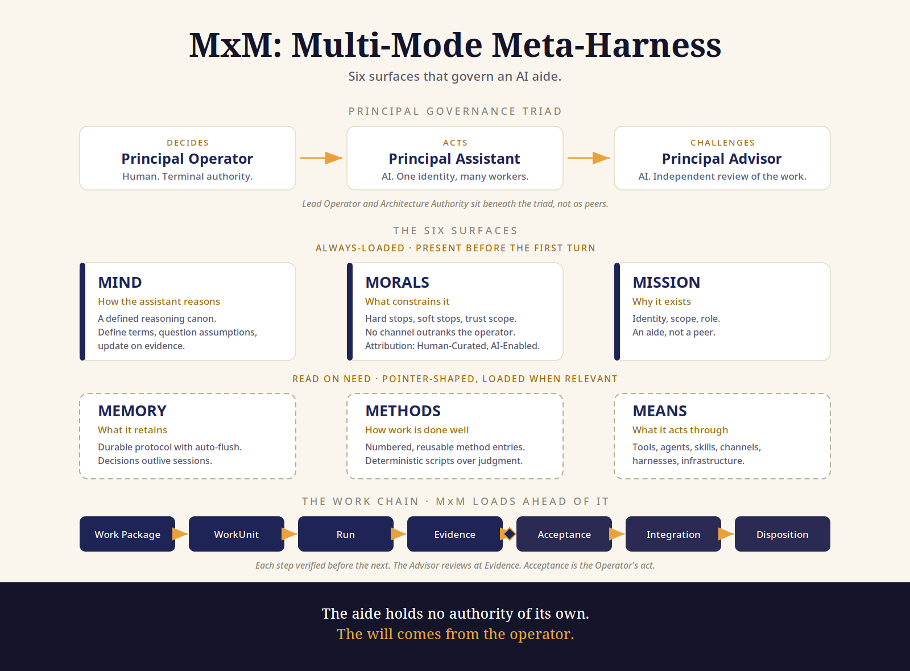

# MxM Fabric — the governance plane for agentic AI ecosystems

> **Status (2026-10-25): early access.** The Python reference kernel is released as
> [`mxm-kernel-v0.2.0`](https://github.com/ologos-repos/mxm-fabric/releases/tag/mxm-kernel-v0.2.0)
> with its conformance suite. One private reference deployment vendors that release under
> offline verification. There are no external adopters yet, and a Go implementation is the
> target. Treat the architecture as stable enough to evaluate and the code as a reference,
> not a supported library.

MxM Fabric is the governed fabric built on the MxM (multi-mode meta-harness)
kernel: the governance and enforcement layer for agentic AI ecosystems. It
covers the six MxM surfaces (Mind, Morals, Mission, Memory, Methods, Means)
and the MCP framework through which any engine reaches them, and this
repository is the standalone reference implementation and conformance
authority for that layer.

It is for operators and builders running more than one agent under one
authority: anyone who needs to know who authorized an action, what evidence
supports a claim, and who accepted a result, with those answers enforced by
the harness rather than left to convention. This repository is the home of
MxM fabric work; fabric-specific scope is defined in its baselines and work
packages as the work lands.

**Names.** The repository is `mxm-fabric`. The component it releases is the **MxM kernel**,
tagged `mxm-kernel-vX.Y.Z`; the kernel kept its name when it moved here, so both names are
current and mean different things.

## How it relates to agent frameworks

MxM Fabric is not an agent framework and does not compete with LangGraph, AutoGen or a
vendor's coding CLI. It is the governance layer underneath them: who may authorize an act,
what evidence a result carries, what memory may be admitted, and who accepts the outcome.
The kernel answers per-action questions locally and offline; it does not call out to a
service. Adapters for specific frameworks are not published yet. In today's reference
deployment the kernel governs the memory fabric's MCP surface used by its command-line agent
engines; extending kernel enforcement to every tool boundary is the next work (WP-MXK-0010).

**Where the Advisor sits.** The Principal Advisor reviews a work product's evidence before a
human accepts it. It is a station in the work chain, once per work product, not a call in each
agent action's path, so it adds no per-action latency. What it can delay is acceptance, which
is a human decision anyway.

## Architecture viewpoint

The framework laid flat: the Principal Governance Triad, the six surfaces
(Mind, Morals, Mission always loaded; Memory, Methods, Means read on need),
and the work chain, with the Advisor reviewing at Evidence before Acceptance.

The MxM Fabric plate: the ecosystem-level viewpoint, with the reference architecture article and files in [agentic-ai-ecosystem-reference-architecture/](02-systems-baseline/2.2-architecture/agentic-ai-ecosystem-reference-architecture/).

Companion material: the [explainer narrative](02-systems-baseline/2.2-architecture/mxm-explainer/mxm-narrative.md),
the [explainer article](02-systems-baseline/2.2-architecture/mxm-explainer/introducing-mxm.md), and the
[reference architecture](02-systems-baseline/2.2-architecture/MXM-REFERENCE-ARCHITECTURE-0001.md).
Harvested companion essays are in [essays/](02-systems-baseline/2.2-architecture/essays/).
## Publications

The fabric's published record on Zenodo:

- **Governed Execution in Multi-Mode Agent Harnesses: Admission, Authority,
  Memory, Routing, and Closure Patterns (A Mx-Modes Companion)** (2026) — the
  execution-time governance patterns a conformant MxM harness enforces.
  [doi.org/10.5281/zenodo.23367869](https://doi.org/10.5281/zenodo.23367869)
- **Ordinal Systems Architecture: A Control Grammar for Enterprise AI
  Authority** (2026, with Micah Longmire) — the control grammar for enterprise
  AI authority that the SARS operating model and the ecosystem viewpoint draw
  on. [doi.org/10.5281/zenodo.20334233](https://doi.org/10.5281/zenodo.20334233)

## Layout

This repository uses the standard MxM Meta-Harness structure. See [MXM.md](MXM.md), and
[04-work-packages/](04-work-packages/) for bounded delivery records.

## How the kernel in this tree is consumed

**Every meta-harness carries its own self-contained, enforced copy.** A harness adopts a
kernel *release* by vendoring it into its own tree:

- The release is **pinned by hash** in a release manifest.
- The release is **verified offline** by the conformance suite shipped with it, with network
  egress disabled.
- The vendored copy imports and fetches **nothing** from outside the harness, so it works
  in air-gapped environments.
- The **MCP framework ships inside the release**. It is dependency-free: a standard-library
  implementation over stdio, with no third-party SDK.

Authority flows down; evidence flows up. Fixes found in a harness come back as
proposals and ship in a new release. A vendored copy is never edited in place.

**Patch releases.** A fix is a normal pull request here, followed by a new tag (for example
`mxm-kernel-v0.2.1`). A harness takes it with `release.py install --expect <aggregate>`, which
verifies the release offline before replacing the vendored copy; rollback is the same command
with the previous release. The path from merged fix to re-vendored harness is one build and
one install, without editing anything in place.
## Lineage

**Kernel home (2026-10-23).** This repository is the MxM kernel's home and source of
truth. The former standalone kernel repository is archived and read-only; its code was
byte-identical to this tree's at the move. The Go kernel remains the target
implementation, with the Python kernel here as its pattern source. Kernel releases are
tagged here as `mxm-kernel-vX.Y.Z`; the first is `mxm-kernel-v0.2.0`. Changes land by
pull request on the development process home, where `main` is protected and the CI
suite is a required gate.

The tree began on 2026-10-23 as a full copy of the kernel repository and has
grown since. The delivery records
(`04-work-packages/WP-MXK-*`, `00-meta-model/decisions/ADR-MXK-*`) and the
release identity (`mxm-kernel` in `05-mxm-construct/means/release/`) are
retained as historical and component records; living identity surfaces
(this README, MXM.md, the repo description) carry the mxm-fabric name.
## Kernel roadmap

| Step | Work | Status |
|---|---|---|
| 1 | Stand-up: process home, protected `main`, CI, ref mirror | Done (WP-MXK-0001) |
| 2 | Reconciled enforcement core (identity-bound ports, chained Evidence, persisted halt, traceability) | Done (WP-MXK-0002) |
| 3 | Release and vendoring contract: manifest, hash pinning, offline verifier, no-external-import check | Done (WP-MXK-0003, ADR-MXK-0001) |
| 4 | Self-contained MCP framework (stdlib, stdio) with delegation binding; registering it with each engine is harness-side | Done (WP-MXK-0004, ADR-MXK-0002) |
| 5 | Signed, single-use, act-bound authorizations and one transactional event log | Done (WP-MXK-0005 to 0007, ADR-MXK-0003 to 0005) |
| 6 | Memory and federation enforcement: memory operations as governed actions; one delegation model that only narrows | **Partial.** Failed memory writes are recorded and denied; durable memory before acceptance is still pending in the traceability record; federation is not yet built (WP-MXK-0013 approved) |
| 7 | First release, and its first vendored adoption | Done: `mxm-kernel-v0.2.0`, vendored by one private reference deployment |

Next: cross-runtime conformance (WP-MXK-0010), capability assessment (WP-MXK-0011), the
Epistemic Assurance Framework minimum implementation (WP-MXK-0012), governed TMF retrieval
(WP-MXK-0013), and the Go kernel.

Human-Curated, AI-Enabled (HCAE)
